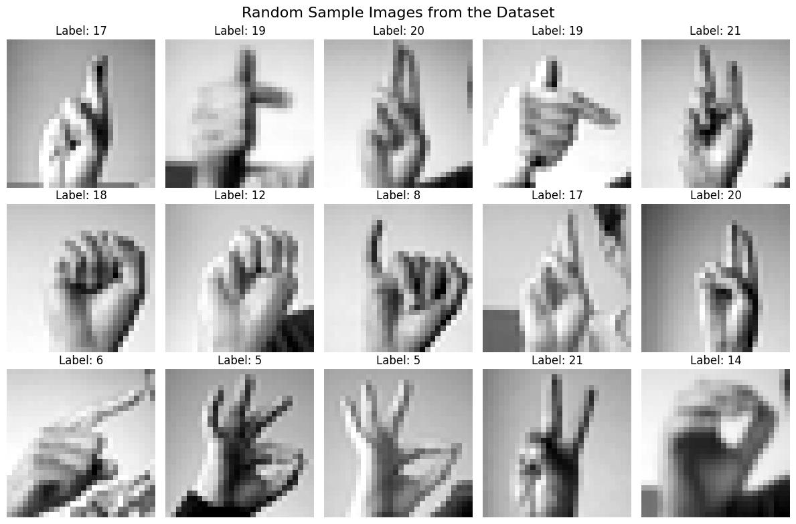
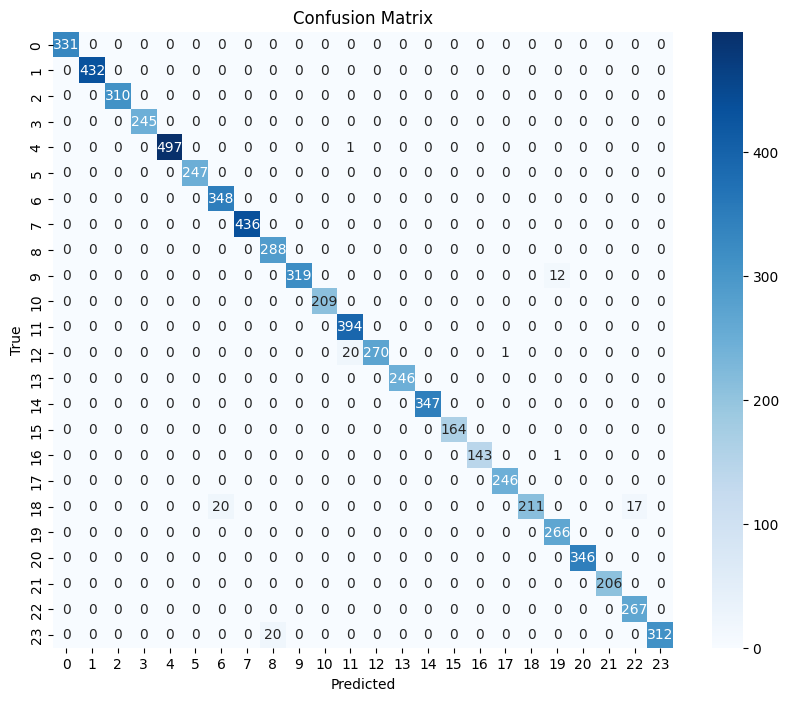
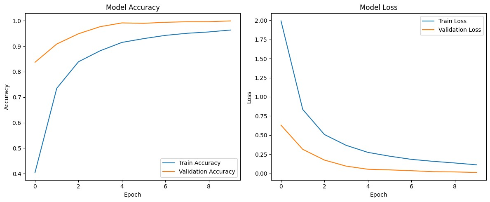

# Sign Language Recognition with a CNN

[](https://colab.research.google.com/github/aniketnandi/sign_language_cnn/blob/main/sign_language_cnn.ipynb)

A convolutional neural network built in TensorFlow/Keras that classifies static American Sign Language (ASL) hand signs from grayscale images. It reaches **98.72% accuracy** on a held-out test set of 7,172 images.

**Highlights**
- **98.72% test accuracy** with a compact 227K-parameter CNN
- **Real-time webcam demo** that combines classical computer vision (background subtraction and contours) with the CNN
- **Failure analysis and a fix:** diagnosed why the pixel model failed on live video (domain shift), then built a second pipeline on MediaPipe hand landmarks that recognizes all 26 letters live at ~30 FPS
- **Deployment:** int8-quantized TFLite and ONNX exports that are **3.8× smaller** with a 0.18-point accuracy cost, and run **700–1,100× faster per frame** than the original Keras inference

## Quick start

**Try the live webcam demo** (needs Python 3.10+ and a webcam; no dataset or TensorFlow required):

```bash
git clone https://github.com/aniketnandi/sign_language_cnn.git
cd sign_language_cnn
pip install -r requirements-demo.txt
python realtime_demo.py
```

Keep your hand out of the green box for ~2 seconds while it learns the background, then sign a letter inside it. Press `q` to quit. Live predictions from this pixel CNN are unreliable: webcam frames look different from the 28×28 training images. [Live Recognition with Hand Landmarks](#live-recognition-with-hand-landmarks) explains why, and describes the landmark-based pipeline that fixes it.

**Run the training notebook in your browser:** click **Open in Colab** above, then *Runtime → Run all*. The dataset downloads automatically and training takes a few minutes.

## Repository layout

| Path | What it is |
|---|---|
| `sign_language_cnn.ipynb` | Data exploration, training and evaluation of the CNN |
| `sign_language_cnn.h5` | Trained Keras model |
| `realtime_demo.py` | Live webcam recognition with the int8 CNN |
| `landmark_asl.py` | Live recognition from MediaPipe hand landmarks (collect, train, run) |
| `export_models.py` | Converts the CNN to TFLite and ONNX, in float32 and int8 |
| `benchmark.py` | Size, accuracy and latency comparison of all model formats |
| `models/` | The exported TFLite and ONNX models |
| `requirements-demo.txt` | Minimal dependencies for the webcam demo |
| `requirements.txt` | Everything: notebook, both demos, export and benchmark |
| `images/` | Figures used in this README |



## Results

| Metric | Validation | Test |
|---|---|---|
| Accuracy | 99.95% | **98.72%** |
| Loss | 0.0129 | 0.0478 |
| Macro F1 | – | 0.99 |



### Where the model struggles

Most classes score a perfect 1.00 F1. The errors are concentrated in a few pairs of hand shapes that look similar at 28×28 resolution:

| True letter | Recall | Most often confused with |
|---|---|---|
| T | 0.85 | G, X |
| N | 0.93 | M |
| Y | 0.94 | I |
| K | 0.96 | U |

N and M, for example, differ only in how many fingers fold over the thumb, which is hard to resolve in such small images.

## Dataset

[Sign Language MNIST](https://www.kaggle.com/datasets/datamunge/sign-language-mnist) (Kaggle):

- **27,455** training images and **7,172** test images
- 28×28 grayscale, stored as flattened pixel rows in CSV files
- **24 classes**, covering A–Y except J. J and Z are left out because they require motion.

The classes are roughly balanced, at about 950–1,300 training images each.

## Approach

**Preprocessing**
- Pixel values normalized to [0, 1] and reshaped to (28, 28, 1)
- Labels one-hot encoded
- Training data split 80/20 into train and validation sets (`random_state=42`)

**Data augmentation** (`ImageDataGenerator`)
- Rotation ±10°, zoom 10%, horizontal and vertical shifts of 10%

**Model architecture**

```
Conv2D(32, 3×3, ReLU) → MaxPool(2×2)
Conv2D(64, 3×3, ReLU) → MaxPool(2×2)
Flatten → Dense(128, ReLU) → Dense(softmax)
```

**Training**
- Adam optimizer with categorical cross-entropy loss
- Batch size 64, 10 epochs

Validation accuracy rose from 83.7% after the first epoch to 99.95% by the tenth, with validation loss falling steadily the whole time.



## Running the notebook

The quickest way to run the notebook is [in Colab](https://colab.research.google.com/github/aniketnandi/sign_language_cnn/blob/main/sign_language_cnn.ipynb). To run it locally:

1. Install the dependencies:
   ```bash
   pip install -r requirements.txt
   ```
2. Open `sign_language_cnn.ipynb` and run all cells. The notebook downloads the dataset with `kagglehub` the first time. To use a copy you already have, place `sign_mnist_train.csv` and `sign_mnist_test.csv` in a `Sign Language MNIST/` folder next to the notebook.

The trained model is saved as `sign_language_cnn.h5`.

## Real-Time Webcam Demo

`realtime_demo.py` runs the CNN on live webcam video on CPU.
It uses classical CV to find the hand first: MOG2 background subtraction,
morphological filtering, and contour detection, then crops the hand to 28×28
and classifies it.

Classification uses the int8 TFLite export (`models/sign_language_cnn_int8.tflite`, see [Model Export](#model-export-int8-tflite-and-onnx)), which takes ~0.05 ms per frame. The earlier Keras version spent ~60 ms per frame in `model.predict` and ran at ~17 FPS. Inference runs on `ai-edge-litert` if it is installed, and on TensorFlow's bundled interpreter if not.

```bash
pip install -r requirements.txt
python realtime_demo.py
```
Keep your hand out of the green box for ~2 seconds while it learns the
background, then sign inside it. Press `r` to relearn the background, `q` to quit.

**Note:** live accuracy is lower than the 98.7% test accuracy because webcam
frames differ from Sign MNIST images (domain shift).

## Live Recognition with Hand Landmarks

### Why a second approach?
The pixel-based CNN scores 98.7% on the Sign MNIST test set, but almost 0% on live webcam video. Debugging showed three causes:
- **Domain shift:** webcam lighting, camera, and background differ from Sign MNIST images
- **Forearm in the crop:** Sign MNIST shows only the hand; live crops included the arm
- **Confident misclassification:** the model was often 99–100% sure and wrong, and biased toward "O"

### The fix
`landmark_asl.py` replaces pixels with hand geometry:
1. **MediaPipe Hands** finds 21 hand-joint landmarks in each frame, regardless of background
2. Landmarks are normalized to the wrist and scaled by hand size, which makes them position- and scale-invariant (42 features)
3. A **Random Forest** trained on 5,600+ self-collected samples across all 26 letters classifies the handshape
4. Predictions are smoothed with a majority vote over recent frames

### Results
- Recognized **all 26 letters** in live webcam testing at **~30 FPS** on CPU
- Similar handshapes (M/N/S/T, U/V/R) are less stable
- J and Z involve motion in ASL; a static-landmark model can only approximate them
- Held-out accuracy on recorded samples is 100%, but this is inflated because consecutive frames are nearly identical. Live testing is the meaningful metric.

### Run it
Download the MediaPipe hand model into this folder:
[hand_landmarker.task](https://storage.googleapis.com/mediapipe-models/hand_landmarker/hand_landmarker/float16/1/hand_landmarker.task)

```bash
pip install -r requirements.txt
python landmark_asl.py collect   # record samples: press a letter key to record, SPACE to stop, ESC to save
python landmark_asl.py train     # train and evaluate the classifier
python landmark_asl.py run       # live recognition
```

## Model Export: int8 TFLite and ONNX

`export_models.py` converts `sign_language_cnn.h5` into four deployable models in `models/`:

| File | Format | Quantization |
|---|---|---|
| `sign_language_cnn_fp32.tflite` | TFLite | none (float32) |
| `sign_language_cnn_int8.tflite` | TFLite | full-integer int8: weights, activations, input and output |
| `sign_language_cnn_fp32.onnx` | ONNX (opset 17) | none (float32) |
| `sign_language_cnn_int8.onnx` | ONNX (opset 17) | static int8, QDQ format, per-channel weights |

The int8 models are calibrated on 500 random **training** images, so the test set is never seen during quantization. The int8 TFLite model takes and returns int8 tensors. Use the scale and zero point from `get_input_details()` / `get_output_details()` to convert (`benchmark.py` shows how).

```bash
pip install -r requirements.txt
python export_models.py --data-dir "Sign Language MNIST"
python benchmark.py --data-dir "Sign Language MNIST"
```

### Before and after

Measured on the full 7,172-image test set. Latency is for one image (batch 1) on one CPU thread, the same work the webcam demo does each frame. Median over 1,000 runs (100 for `model.predict`) on an Intel Xeon @ 2.8 GHz.

| Model | Size | Test accuracy | Agrees with Keras | Median latency | p95 latency |
|---|---|---|---|---|---|
| Keras `.h5`, `model.predict` (what `realtime_demo.py` used before) | 2,700 KB | 98.72% | – | 60.6 ms | 76.5 ms |
| Keras `.h5`, `tf.function` call | 2,700 KB | 98.72% | – | 0.67 ms | 1.07 ms |
| TFLite fp32 | 891 KB | 98.72% | 100.00% | 0.078 ms | 0.12 ms |
| **TFLite int8** | **233 KB** | **98.54%** | **99.76%** | **0.055 ms** | **0.11 ms** |
| ONNX fp32 | 890 KB | 98.72% | 100.00% | 0.084 ms | 0.15 ms |
| **ONNX int8** | **240 KB** | **98.54%** | **99.76%** | **0.087 ms** | **0.14 ms** |

What the numbers show:
- **Size:** int8 cuts the model to about **3.8×** smaller than float32 (891 KB → 233 KB) and **11.6×** smaller than the `.h5`. The `.h5` is bigger than the weights alone because it also stores Adam optimizer state.
- **Accuracy:** int8 costs **0.18 points** (98.72% → 98.54%). It changes the predicted letter on 17 of 7,172 test images (0.24%). The float32 exports match Keras exactly.
- **Speed:** most of the speedup comes from leaving Keras, not from int8. `model.predict` spends ~60 ms per call on setup, so any TFLite or ONNX export is **700–1,100× faster per frame** than the original demo. `realtime_demo.py` now uses the int8 TFLite model. Compared with a direct Keras call, TFLite int8 is ~12× faster. Against float32 TFLite, int8 is ~1.4× faster. ONNX Runtime int8 runs at about the same speed as ONNX fp32: at 227K parameters the per-call overhead outweighs the cheaper int8 math on x86. The int8 ONNX model is still the one to ship for its size, and it should gain more on ARM or VNNI-capable hardware.

## Possible improvements
- Sequence model (LSTM or temporal CNN) over landmark sequences to properly handle J and Z
- More training data from multiple people and lighting conditions to improve robustness
- PyTorch port, and C++ deployment of the ONNX export via OpenCV DNN

## License

The code in this repository is released under the [MIT License](LICENSE). The Sign Language MNIST dataset is not included and is distributed separately on Kaggle under its own terms.
